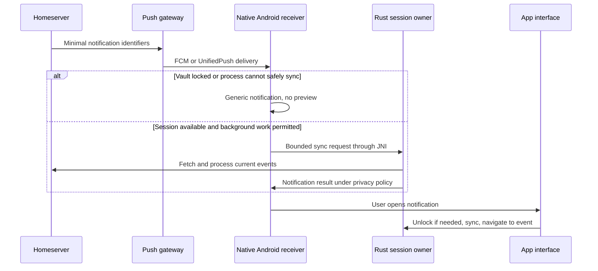

# Implementation architecture

Status: proposed implementation design, ready for the feasibility stage. Research and source links are in [RESEARCH.md](RESEARCH.md).

## Repository boundaries

```text
apps/client/                 React, TypeScript, CSS, Vite
apps/client/src-tauri/       Tauri shell and platform configuration
crates/client-core/         SDK lifecycle, sessions, rooms, timelines, media
crates/app-storage/         App-owned encrypted settings and drafts
crates/platform-secrets/    Windows/Linux/Android secret adapters
crates/experimental-mls/    Optional MLS integration, initially disabled
plugins/mobile-services/   Kotlin push/lifecycle/Keystore bridge
packages/ui-contract/      Generated/checked frontend command types
packages/theme-format/     Theme schema, parsing, validation
tests/fixtures/            Synthetic rooms, themes, message payloads
docs/                     Design, evidence, release instructions
```

This is the intended layout, not an existing application scaffold. Start with the minimum modules needed and split crates when their responsibilities justify it.

## Runtime ownership

One core session owner manages each active account's Matrix client, database handles, background tasks, and subscriptions. The first UI supports one account, while local directories and message identifiers are already account-scoped. Desktop prevents concurrent instances opening the same profile. Android uses one coordinated session owner across native receivers and the activity.

React renders snapshots and incremental changes. Use virtualized timelines; subscribe to the visible room, a bounded room list, and unread summaries. Cancel subscriptions when views change. Tag events with account/session generation so stale results cannot appear after logout or account replacement.

Suggested commands: discover server, begin/complete login, restore session, list rooms/spaces, subscribe/unsubscribe timeline, send/retry/cancel message, upload attachment, verify device, manage recovery, set privacy preference, validate/apply theme, lock, logout. Commands accept typed IDs and bounded inputs. No generic shell command, arbitrary filesystem path, raw SQL, or key-export command is available to normal chat rendering.

Send status is a state machine: draft → queued → sending → sent, with retryable/terminal failure and cancellation. Reuse stable transaction IDs when retrying; reconcile local echoes with server events. Use the SDK's send queue where it meets these needs. Persist drafts and queue data through encrypted stores. Respect SDK errors and server backoff.

## Login and sync

Discovery checks the homeserver, authentication methods, supported versions, and native Sliding Sync capability. HTTPS is required outside explicitly isolated local development. Preserve custom homeserver choice. Validate redirects and authorization state through the SDK's supported auth flow.

First supported sync path: `matrix-sdk-ui` room list/timeline with native Simplified Sliding Sync. Show an actionable compatibility message for unsupported servers. Do not silently add an external sync proxy. A later classic-sync adapter can widen compatibility without changing UI contracts.

Membership, encryption state, and verification are live data. Recheck sending policy in the core at send time, rather than trusting a badge displayed earlier. Treat missing keys, denied key requests, revoked sessions, and identity changes as distinct user states.

## Android background flow



Push is a hint, not trusted message content or a complete event log. Dedupe hints, validate account mapping, tolerate missing/collapsed deliveries, and fetch authoritative state after resume. Never claim a sender or message content from an unauthenticated hint. Native receivers must avoid starting duplicate SDK instances or holding database locks indefinitely.

The default locked notification is generic and opens the app. Rich previews and inline reply are later opt-ins after lock semantics are verified. Do not assume foreground JavaScript timers or a permanent background connection will run. Distinguish OS process reclamation from a deliberate force-stop when reporting reliability.

## Storage and locking

Keep app data in platform application-data directories outside the source checkout. Store SDK databases separately from app settings/drafts. Put themes and non-secret appearance preferences in a distinct directory. Use random account-local directory identifiers rather than exposing account names in filenames where practical.

The platform-protected secret wraps/unlocks the local data key. Never store the data key beside the database as plaintext. Strong vault mode uses a reviewed password-based wrapping construction and keeps its unlock secret separate from the OS account. Linux without an available secret service uses this mode or session-only access.

Locking clears displayed messages, revokes frontend session handles, stops private previews, and releases SDK/store instances and key references where possible. Memory erasure is best effort across runtimes. OS credential protection alone does not add a separate password barrier against software running as that same user. See the full distinction in [SECURITY.md](SECURITY.md).

Migrations are versioned and crash-safe. Keep encrypted recovery data/backups before destructive schema transitions, migrate under exclusive ownership, and validate before deleting prior data. Release downgrade policy must account for irreversible SDK schema changes.

## Frontend and theme boundaries

The frontend loads bundled application code. Network and authenticated media retrieval go through the core. Render sanitized Matrix content; no active message HTML, embedded scripts, or uncontrolled remote image/font loads. Local media handles are opaque, bounded, account-scoped, and invalidated on lock/logout. Explicit file export leaves the protected app store.

Theme v1 supports typed variables and allowed local assets. Advanced CSS is local opt-in trusted input with parser validation and restricted resources. It must be contained inside the customizable workspace; credentials, verification/recovery, mode indicators, and theme-reset controls live outside it. Prototype a contained document/frame boundary and its accessibility behavior before deciding the implementation. Unload all custom CSS for protected screens. Selector rewriting alone is insufficient evidence of containment.

Executable extensions, arbitrary remote themes, and a public theme marketplace are separate later projects. Community distribution can start with validated token-only themes. Full CSS import remains a planned feature, contingent on the containment gate.

## Platform adapters and fallback

| Platform | Initial implementation target | Fallback if a gate fails |
| --- | --- | --- |
| Windows | Tauri/WebView2, user-scoped DPAPI, native installer | Resolve webview/SDK issue before widening support |
| Linux | Tauri/WebKitGTK, Secret Service, AppImage plus Debian package | Password vault if secret service is unavailable; package for tested distributions |
| Android | Tauri WebView, Kotlin services, JNI, Keystore | Keep shared Rust core; evaluate a Kotlin host with the same web interface before considering a full native UI rewrite |

An Android fallback is a decision triggered by failed feasibility evidence, not a second app to build in parallel now.
